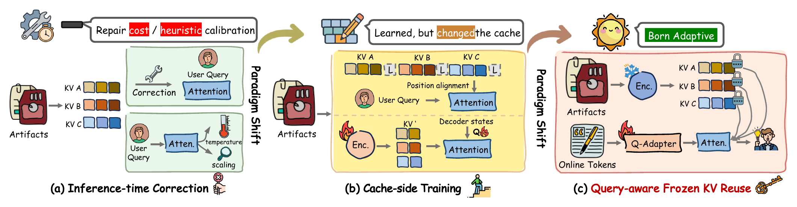
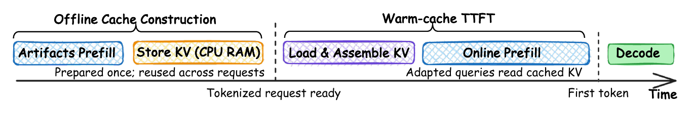

# ATTUNER: Recomputation-Free KV Cache Reuse via Query-Side Adaptation

[](https://arxiv.org/abs/2609.36722)
[](https://arxiv.org/pdf/2609.36722)
[](https://skycxh.github.io/attuner-project-page/)
[](#citation)

**Learn to read a frozen cache, without rewriting it.**

Attuner trains small query-projection adapters to read independently cached
artifacts. The base model and stored artifact KV remain unchanged. One adapter
per base model is trained on skills, documents and memory messages together.

This repository provides data preparation, Full/PIC/PIC-Pos evaluation,
teacher-response collection, adapter training, evaluation after training, and
six comparison methods. **Model weights and teacher responses are not included.**
Historical experiment launchers and visualization code are not included.



*ATTUNER adapts online queries while keeping independently constructed artifact KV unchanged.*

### Workflow

1. [Install the environment](#1-install) and [prepare models and datasets](#2-download-base-models-and-prepare-datasets).
2. [Evaluate Full, PIC and PIC-Pos](#3-evaluate-full-pic-and-pic-pos) as references.
3. [Collect teacher responses](#4-collect-full-teacher-responses), [train ATTUNER](#5-train-attuner), and [evaluate the adapter](#6-evaluate-after-training).
4. [Run comparison methods](#7-other-baselines) and [measure efficiency separately](#8-measure-efficiency-separately).

## 1. Install

Use Linux, an NVIDIA GPU, and a CUDA-compatible NVIDIA driver.

After cloning or downloading this repository:

```bash
cd Recomputation-free-KV-Reuse
conda env create -f environment.yml
conda activate attuner
python -m pip install --upgrade pip
python -m pip install torch==2.8.0
python -m pip install -e '.[test]'
python -m pip install -e third_party/SR-Agents
python -m pip install tensorflow-cpu==2.20.0
python -m pip check
```

SR-Agents installs the benchmark scoring dependencies, including BigCodeBench's
test libraries. TensorFlow is installed separately for tasks that import it.
**No Docker image or external setup.sh is required.** BigCodeBench evaluates
generated code in local subprocesses; use a disposable environment without
credentials or important files. Its resource guard is not a security sandbox.

Run all commands below from the repository root with this environment active.
Core runtime versions are PyTorch 2.8.0 and Transformers 4.57.1. The package does
not silently upgrade Transformers to the versions used by older experiment scripts.

## 2. Download base models and prepare datasets

```bash
hf download Qwen/Qwen3-4B --local-dir models/Qwen3-4B
# Optional: repeat the experiments on 8B.
hf download Qwen/Qwen3-8B --local-dir models/Qwen3-8B

python -m attuner.prepare --download
```

Preparation downloads the official SRA-Bench, MuSiQue and PersonaMem-v2 inputs,
applies the included fixed sample/skill partitions, and writes `data/prepared/`.
It does not download teacher responses or trained adapters.

| Dataset | Evaluation examples | Context | Metric |
|---|---:|---|---|
| TheoremQA | 747 | Annotated skill | Accuracy |
| LogicBench | 760 | Annotated skill | Accuracy |
| MedCalc-Bench | 1,100 | Annotated skill | Accuracy |
| CHAMP | 223 | Annotated skills | Accuracy |
| BigCodeBench | 667 | Annotated skills; skill-disjoint test partition | pass@1 |
| MuSiQue | 2,417 | Supporting documents only | EM / F1 |
| PersonaMem-v2 | 5,000 | Relevant annotated messages only | Accuracy |

MuSiQue uses the official answerable **dev split as the evaluation set** because
its hidden test answers are not public. PersonaMem uses the GT-message setting,
not full conversation histories. Standard skill prompts retain their separators.

The shared training mixture contains 4,000 MuSiQue questions, 4,000 PersonaMem
questions and 4,000 synthetic BigCodeBench skill-use questions. The synthetic
questions and skill IDs are included under `data/synthetic/`; they contain no
teacher answers. Training-side BigCodeBench skills are disjoint from evaluation
skills, and PersonaMem training personas are disjoint from evaluation personas.
The exact selections are in `data/splits/`.

If the official MuSiQue Google Drive download is unavailable, follow the
[author download instructions](https://github.com/StonyBrookNLP/musique), put
`musique_ans_v1.0_train.jsonl` at `data/raw/musique/train.jsonl` and
`musique_ans_v1.0_dev.jsonl` at `data/raw/musique/dev.jsonl`, then rerun preparation.
Already downloaded files are reused.

## 3. Evaluate Full, PIC and PIC-Pos

Choose a local model and its configuration:

```bash
export MODEL="$PWD/models/Qwen3-4B"
export CONFIG=configs/qwen3_4b.yaml
export GPU_IDS=0,1
```

For 8B, set `MODEL="$PWD/models/Qwen3-8B"` and
`CONFIG=configs/qwen3_8b.yaml`. Set `GPU_IDS` to the devices you want to use.

```bash
python -m attuner.benchmark \
  --config "$CONFIG" --model "$MODEL" --gpus "$GPU_IDS" \
  --methods full,pic,pic-pos \
  --output "results/quality/$(basename "$MODEL")/reference"
```

By default this evaluates all seven datasets. To select a subset, add
`--datasets champ,bigcodebench,musique,personamem_v2`.
`pic-pos` is the CLI alias for `position_oracle`.

Each GPU generates a different sample shard. CPU scoring of a completed dataset
can run while the next dataset generates answers. Quality generation does not
report TTFT. Logs are under each method/dataset directory as `worker-0.log`, etc.;
`predictions.jsonl` contains answers and `summary.json` contains final metrics.

Rerun the same command to resume. Keep the same GPU count while resuming a
partially generated dataset. If only scoring failed, add `--score-only`; this
does not load a GPU model. Use a new output directory after changing model
weights, data, adapter or inference settings.

## 4. Collect Full teacher responses

No prepared teacher files are distributed. Generate them with the corresponding
base model, using the fixed training questions from step 2:

```bash
python -m attuner.benchmark --collect \
  --config "$CONFIG" --model "$MODEL" --gpus "$GPU_IDS" \
  --output "results/teachers/$(basename "$MODEL")"
```

This uses greedy Full prefill with thinking disabled. It generates up to 256
response tokens for MuSiQue and PersonaMem, and 1,024 for BigCodeBench. Responses
and token IDs are saved under `data/teachers/<model-name>/` for training.
The same command resumes missing examples. Collect separate responses for 4B
and 8B; do not train one model using the other model's responses.

Training recomputes Full teacher distributions on these saved prefixes.
This is distribution KL supervision, not just cross-entropy on sampled answers.

## 5. Train Attuner

```bash
CUDA_VISIBLE_DEVICES=0,1 torchrun --standalone --nproc_per_node=2 \
  -m attuner.train --config "$CONFIG" --model "$MODEL" \
  --output "checkpoints/$(basename "$MODEL")/attuner"
```

Set `--nproc_per_node` to the number of visible GPUs.

Defaults: all layers L0–35, query projections only, rank 8, alpha 16, AdamW,
learning rate 2e-4, one epoch and global batch 16. Micro-batch is 1; gradient
accumulation is computed automatically from the GPU count.
Full teacher and PIC student use the same prompt and response prefix.
Artifact KV is built with adapters disabled. No training-performance diagnostic
is required before starting a run.

The adapter is exported to `checkpoints/<model-name>/attuner/adapter/`.
Rerun the same training command to resume from its saved optimizer state.
Use a new output directory if the training configuration or GPU count changes.
Since responses are regenerated and software/hardware can differ, new runs are
not guaranteed to reproduce each published score exactly.

## 6. Evaluate after training

```bash
export ADAPTER="$PWD/checkpoints/$(basename "$MODEL")/attuner/adapter"

python -m attuner.benchmark \
  --config "$CONFIG" --model "$MODEL" --gpus "$GPU_IDS" \
  --adapter "$ADAPTER" --methods pic_attuner,full_attuner \
  --output "results/quality/$(basename "$MODEL")/attuner"
```

`pic_attuner` is Attuner with independently cached artifacts. `full_attuner`
applies the same adapter under Full prefill as a control. This command loads the
trained adapter; it does not start training or regenerate teacher responses.

For a quick end-to-end smoke test, use `--datasets musique --limit 2
--max-new-tokens 8` and a separate output directory. Such a subset is not a
formal benchmark result.

## 7. Other baselines

The six methods are isolated in `baselines/`. Their code sources and adaptation
settings are listed in [baselines/README.md](baselines/README.md).

**Training-free quality evaluation:**

```bash
python -m attuner.benchmark \
  --config "$CONFIG" --model "$MODEL" --gpus "$GPU_IDS" \
  --methods ape,epic,cacheblend,agentkvshift \
  --datasets champ,bigcodebench,musique,personamem_v2 \
  --output "results/quality/$(basename "$MODEL")/training_free"
```

**Train KVLink and COMB:** first complete steps 2 and 4. They use the same
mixed12k questions and teacher responses, with their own response-CE objectives.
KVLink trains the backbone and link embeddings; COMB trains its encoder and
cross-attention modules with the decoder frozen. Their memory requirements can
be substantially higher than Attuner's.

```bash
for method in kvlink comb; do
  internal="$method"
  if [ "$method" = comb ]; then internal=encoder_pic; fi
  CUDA_VISIBLE_DEVICES=0,1 torchrun --standalone --nproc_per_node=2 \
    -m baselines.train_mixed "$method" \
    --config "$CONFIG" --model "$MODEL" --accumulation 8 \
    --output "checkpoints/$(basename "$MODEL")/baselines/$internal"
done
```

For these baselines, set `--accumulation` to `16 / GPU count` to retain global
batch 16. For a small end-to-end check, use `--data <prepared-subset.jsonl>` with
matching teacher responses, `--global-batch-size 1 --accumulation 1`, and a
separate output directory. A KVLink subset must include at least as many
artifacts in one example as the largest evaluation request, since training
allocates its link-token groups. The full mixed12k mixture covers the supplied
evaluation sets. Evaluation is a separate command:

```bash
python -m attuner.benchmark \
  --config "$CONFIG" --model "$MODEL" --gpus "$GPU_IDS" \
  --methods kvlink,comb \
  --training-dir "checkpoints/$(basename "$MODEL")/baselines" \
  --datasets champ,bigcodebench,musique,personamem_v2 \
  --output "results/quality/$(basename "$MODEL")/training_based"
```

All seven datasets, including TheoremQA, are supported by the common quality
entry point. Method names in output directories use `encoder_pic` for COMB.

## 8. Measure efficiency separately



*Artifact KV is prepared once and reused across requests. Warm-cache TTFT covers cache loading and assembly, online prefill, and first-token selection; offline cache construction and subsequent decoding are excluded.*

Use `baselines/measure_efficiency.py` for every method. Wait for other workloads
on the selected GPU to finish. This entry point does not enforce a GPU-occupancy
gate; avoiding concurrent work is the operator's responsibility.

```bash
python -m baselines.measure_efficiency \
  --config "$CONFIG" --model "$MODEL" --gpu 0 \
  --adapter "$ADAPTER" --merge-adapter \
  --datasets champ,bigcodebench,musique,personamem_v2 \
  --methods full,pic,position_oracle,pic_attuner \
  --output "results/ttft/$(basename "$MODEL")/attuner"
```

This merges query updates for online Attuner inference while constructing
artifact caches using the original base weights. To measure references before
training, omit `--adapter`, `--merge-adapter` and `pic_attuner`.

Training-free methods:

```bash
python -m baselines.measure_efficiency \
  --config "$CONFIG" --model "$MODEL" --gpu 0 \
  --methods full,pic,ape,epic,cacheblend,agentkvshift \
  --output "results/ttft/$(basename "$MODEL")/training_free"
```

Trained methods:

```bash
python -m baselines.measure_efficiency \
  --config "$CONFIG" --model "$MODEL" --gpu 0 \
  --methods full,kvlink,comb \
  --training-dir "checkpoints/$(basename "$MODEL")/baselines" \
  --output "results/ttft/$(basename "$MODEL")/training_based"
```

To measure single-artifact tasks, set
`--datasets theoremqa,logicbench,medcalcbench`. The default runs use all examples,
batch size 1, five untimed warm-up requests and one timed first-token generation
per example. Reusable KV is in CPU RAM before timing. The timer includes RAM
lookup, GPU transfer, assembly, online repair/prefill and greedy first-token
selection; it excludes model loading, tokenization, offline cache construction,
subsequent generation and scoring.

Each method/dataset directory contains `timings.jsonl` and `summary.json`.
Speedup uses the Full median divided by the method median on matched examples
from the same timing run. These are timings of our common Qwen3 ports, not of
the upstream projects' original serving engines.

## Sources and license

- [SRA-Bench / SR-Agents](https://github.com/oneal2000/SR-Agents)
- [MuSiQue](https://github.com/StonyBrookNLP/musique)
- [PersonaMem-v2](https://github.com/bowen-upenn/PersonaMem-v2)
- [APE](https://github.com/Infini-AI-Lab/APE), [EPIC](https://github.com/DerekHJH/epic),
  [CacheBlend](https://github.com/YaoJiayi/CacheBlend),
  [KVLink](https://github.com/UCSB-NLP-Chang/KVLink),
  [COMB](https://github.com/shijuzhao/Comb)

Original code: [Apache-2.0](LICENSE). Third-party code and datasets retain their
own licenses; see [THIRD_PARTY_NOTICES.md](THIRD_PARTY_NOTICES.md).

## Citation

If you use ATTUNER in your research, please cite our paper:

```bibtex
@misc{chen2026attunerrecomputationfreekvcache,
  title         = {ATTUNER: Recomputation-Free KV Cache Reuse via Query-Side Adaptation},
  author        = {Xinghao Chen and Junnan Dong and Cai Ke and Chak Tou Leong and Haocheng Sun and Keyu Chen and Siyu An and Ruizhi Qiao and Xing Sun and Wenjie Li and Xiaoyu Shen},
  year          = {2026},
  eprint        = {2609.36722},
  archivePrefix = {arXiv},
  primaryClass  = {cs.CL},
  url           = {https://arxiv.org/abs/2609.36722}
}
```
